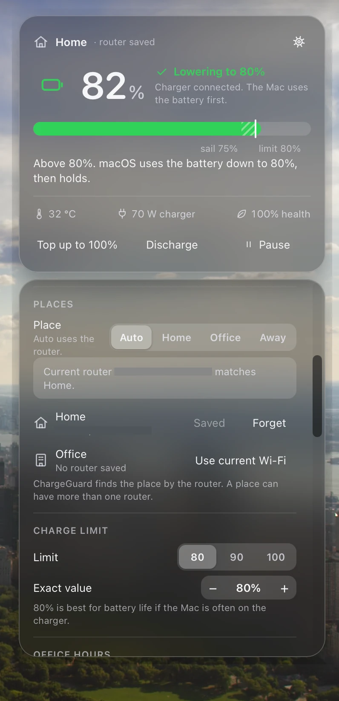

# ChargeGuard

ChargeGuard holds your MacBook battery at 80% at Home and at the Office. At other places, it charges to 100%.
It finds the place from your Wi-Fi router. A widget on the desktop shows the battery and has all settings.

<p align="center">
  
</p>

[**Download the latest release**](https://github.com/adhityaranggap/ChargeGuard/releases/latest)

> NOTE: ChargeGuard is a beta. It is tested on one MacBook Pro M5 with macOS 27.2.1.

## Contents

- [Features](#features)
- [Requirements](#requirements)
- [Install](#install)
- [First setup](#first-setup)
- [Use the widget](#use-the-widget)
- [Command line](#command-line)
- [How it works](#how-it-works)
- [Safety](#safety)
- [Uninstall](#uninstall)
- [Build from source](#build-from-source)
- [Project layout](#project-layout)
- [Roadmap](#roadmap)
- [Third-party parts](#third-party-parts)

## Features

| Feature | What it does |
|---|---|
| Charge limit | Stops charging at a limit from 50% to 100%. The default is 80%. The Mac stays on charger power. |
| Places | Finds Home, Office, or Away from the router. A place can have more than one router. Away charges to 100%. |
| Manual place | You can choose Home, Office, or Away by hand. Auto uses the router again. |
| Office hours | On work days, charges to 100% before the end of the day. Then it goes back to the limit. |
| Sailing | After the limit, charging starts again only below the limit minus a gap. The default gap is 5%. |
| Top up | Charges to 100% one time. It stops when you disconnect the charger. |
| Heat protection | Stops charging at 35 °C. It starts again at 32 °C. |
| Discharge | Uses the battery while the charger is connected, down to a percent that you choose. |
| Calibration | Discharges to 15%, charges to 100%, holds, then goes back to the limit. |
| Schedule | Runs top-up, calibration, limit, or discharge on days and times that you choose. |
| MagSafe LED | Green holds, orange charges, off discharges. |
| Plug-in notice | A notification and a widget banner tell you the place and the target. |
| Desktop widget | 8 themes, size from 70% to 150%, panel height, and screen corner. |
| Menu bar | Optional, with SwiftBar. |

## Requirements

- A Mac with Apple silicon, M1 or later.
- A macOS version with the native charge limit (`pmset -g battlimit`). The installer checks this.
- An admin account. The installer asks for the password one time.

## Install

1. Download `ChargeGuard-<version>.dmg` from [Releases](https://github.com/adhityaranggap/ChargeGuard/releases).
2. Open the disk image. Double-click **Install ChargeGuard**.
3. If macOS says that it cannot check the app, click **Done**.
   Open **System Settings > Privacy & Security**. Scroll down and click **Open Anyway**.
   The app is not signed with an Apple developer account. That is why macOS asks.
4. Click **Install**, and type your Mac password.

The installer copies ChargeGuard to `~/.chargeguard`. It starts two launchd agents: the daemon and the widget.
You do not need Terminal, Homebrew, or Bun. The disk image includes them.

## First setup

1. Find the widget at the bottom left of the screen.
2. Click the gear on the widget. The Settings panel opens.
3. At home, click **Use current Wi-Fi** next to **Home**.
4. At the office, click **Use current Wi-Fi** next to **Office**.

On a network that you did not save, the place is Away, and the Mac charges to 100%.

## Use the widget

Click the gear on the widget to open Settings. All settings are there.

| Section | Settings |
|---|---|
| Widget | Theme, size, panel height, and corner |
| Places | Auto, Home, Office, or Away. Save or forget the routers for each place. |
| Charge limit | 80, 90, or 100, or an exact value |
| Office hours | Days, start, end, and lead time |
| Protection | Heat pause, sailing gap, and Low Power Mode |
| MagSafe LED | On or off |
| Calibration and Schedule | Start a calibration, and add or remove rules |

The card buttons do one-time actions: **Top up to 100%**, **Discharge**, and **Pause**.

Themes: Auto, Dark, Light, Glass, Graphite, Midnight, Sand, and Contrast. Auto follows the macOS appearance.

## Command line

The installer puts the `cg` command in `~/.chargeguard/bin`. It is optional. The widget does the same jobs.

```bash
~/.chargeguard/bin/cg status
~/.chargeguard/bin/cg limit 80
~/.chargeguard/bin/cg place save home
~/.chargeguard/bin/cg place use office
~/.chargeguard/bin/cg topup
~/.chargeguard/bin/cg set widget.theme midnight
~/.chargeguard/bin/cg doctor
```

Run `cg help` to see all commands. Add `--json` to `status` and `doctor` for JSON output.
You can use these commands in the Shortcuts app with a "Run Shell Script" action.

## How it works

```
widget (JXA window + WKWebView)  ──run cg──▶  cg CLI  ──config.json + kick──▶  daemon (Bun)
        ▲                                                                          │
        └──────────────────────── status.json ◀─────────────────────────────────┤
                                                                                   ▼
                                                    sudo -n cg-helper ──▶ native limit, adapter, LED
```

- **Daemon.** `src/daemon.ts` runs as a launchd agent. It reads the battery, asks the policy for a decision, and applies it. It writes `~/.chargeguard/status.json`.
- **Policy.** `src/policy.ts` is a pure function. It takes the battery data, the config, the state, and the time, and it returns the target and the mode. Tests cover it.
- **Place.** ChargeGuard does not use GPS or Location Services. It reads the MAC address of the default gateway with `route` and `arp`. It reads the router only at start, on plug-in, on wake, on a network change, or after 10 minutes on charger power. It never reads the router on battery power.
- **Charge limit.** ChargeGuard sets the native macOS charge limit. macOS keeps the limit, also when ChargeGuard is not running.
- **Hardware writes.** One root helper, `cg-helper`, does 4 jobs: limit, adapter on or off, LED, and Low Power Mode. A sudoers rule allows only this helper, with no password.
- **Widget.** `widget/standalone/host.js` opens a clear window below normal windows. It shows `widget/chargeguard.widget/index.jsx` with local React and Babel files, so it needs no network. The same widget also runs in Übersicht.

## Safety

- If the daemon stops, it turns the adapter on and sets the LED to the system mode.
- If the sensors fail 3 times, the daemon does the same fail-safe.
- The daemon never turns the adapter off below 10%.
- The root helper accepts only fixed commands and fixed values. It does not run other commands.
- `install-root.sh` checks the SHA-256 of the `smc` binary. It stops if `/usr/local` or `/usr/local/libexec` can be written by other users.

## Uninstall

Double-click **Uninstall ChargeGuard** in the disk image. Choose to keep the limit in macOS or to charge to 100%.
The uninstaller stops the agents, turns the adapter on, and removes `~/.chargeguard`, the root helper, and the sudoers rule.

## Build from source

You need [Bun](https://bun.sh) 1.2 or later, and an Apple silicon Mac for the disk image.

```bash
git clone https://github.com/adhityaranggap/ChargeGuard.git
cd ChargeGuard
bun test
bash scripts/install.sh
sudo SMC_SRC=/path/to/smc bash scripts/install-root.sh
```

Make the disk image:

```bash
bash packaging/make-dmg.sh 0.1.0
```

The script writes `dist/ChargeGuard-0.1.0.dmg`. It bundles Bun from `~/.bun/bin/bun` and the installed `smc`. Set `BUN_SRC` and `SMC_SRC` to use other files.

## Project layout

```
src/                 daemon, policy, config, sensors, router read, CLI
widget/              desktop widget: Übersicht widget and the standalone host
scripts/             install, root install, uninstall, root helper
packaging/           disk image script, installer and uninstaller apps, README for users
launchd/             launchd agent templates
swiftbar/, hooks/    optional menu bar plugin and sleepwatcher hooks
tests/               bun tests and status fixtures
docs/                PRD, design, verification, and the native app plan
```

## Roadmap

The next big step is a native Mac app in Swift. It replaces Bun, the JXA widget, SwiftBar, and sleepwatcher.
It uses events instead of polls, so it uses less battery. See [docs/development/PLAN.md](docs/development/PLAN.md).

## Third-party parts

- [Bun](https://github.com/oven-sh/bun), MIT license. The disk image includes it.
- `smc` from the [battery](https://github.com/actuallymentor/battery) project, built from [smcFanControl](https://github.com/hholtmann/smcFanControl). GNU GPL. The disk image includes it.
- [React](https://github.com/facebook/react) 18.3.1 and [Babel standalone](https://github.com/babel/babel) 7.24.7, MIT license. They are in `widget/standalone/vendor`.
